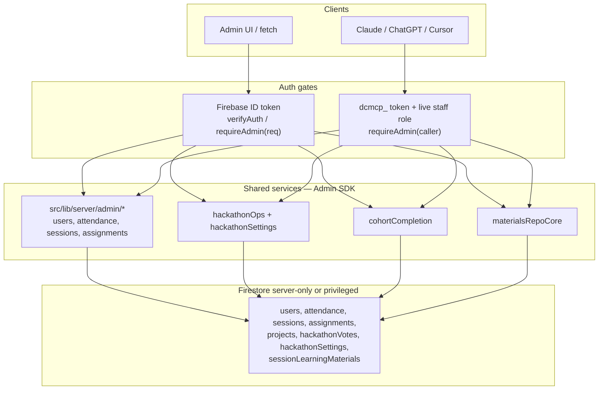
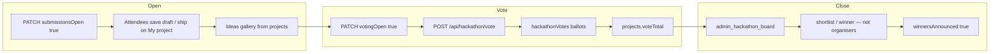
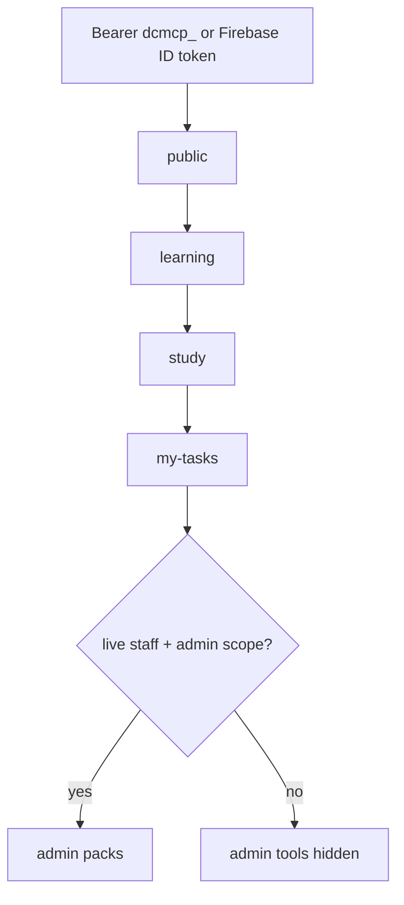

# 16 · Agentic Hackathon + Admin MCP

Closing-day **Agentic Hackathon** (in person + online) and how **Claude / ChatGPT / Cursor** operate it as an organiser — without talking to Firestore on their own.

**Related:** APIs [07](./07-api-routes.md) · schema [03](./03-database-schema.md) · security [04](./04-auth-and-security.md) · Learning MCP [14](./14-learning-assistant.md) · harness [15](./15-agent-harnessing-optimisation.md).

---

## Product surfaces

| Who | URLs |
|-----|------|
| Attendees | `/hackathon`, `/hackathon/my-projects`, `/hackathon/ideas`, `/vote`, `/hackathon/prizes`, `/hackathon/rules` |
| Organisers (site) | `/admin/hackathon`, `/admin` → Projects |
| Organisers (LLM) | `/mcp` mint **admin** `dcmcp_` token → connector **`/api/mcp`** |

One Firestore **`projects/{id}`** document is both the DevCamp **final project** and the hackathon entry (`cohortId` + optional `hackathonId`). Ideas gallery and voting read that collection via **`/api/hackathon/*`** (Admin SDK). Organisers are **prize-ineligible** (`role` admin/moderator).

Luma RSVP (`https://luma.com/wz7509ty`) is the ticket surface. Import guests: `npm run import-luma-guests` or `/admin/import`.

---

## Shared admin layer (one write path)

MCP tokens (`dcmcp_…`) are **not** Firebase ID tokens. Admin MCP therefore does **not** HTTP-loopback into `/api/*` (that would mean accepting MCP tokens on every admin route). Both surfaces call the **same** `src/lib/server/**` modules after their own `requireAdmin`.

| HTTP (`requireAdmin(req)`) | MCP tool (same service) |
|----------------------------|-------------------------|
| `GET /api/admin/hackathon` | `admin_hackathon_board`, `admin_list_projects` |
| `PATCH /api/admin/hackathon` | `admin_update_hackathon_settings` |
| `POST /api/admin/hackathon/recompute-votes` | `admin_recompute_hackathon_votes` |
| `PATCH /api/projects/[id]` | `admin_set_project_status` |
| `GET /api/admin/cohort-completion` | `admin_cohort_completion` |
| `GET`/`PATCH /api/users`, `/api/attendance/[uid]` | `admin_list_users`, `admin_get_user`, `admin_update_user`, `admin_get/set_attendance` |
| `GET`/`PUT /api/sessions` | `admin_list_sessions`, `admin_upsert_session` |
| `GET`/`PATCH /api/assignments/[id]` | `admin_list/get/update_assignment` |
| `GET`/`PUT /api/admin/learning-materials` | `admin_list/upsert_learning_material` |

MCP pack files: `packages/devcamp-mcp/src/admin/` (`users`, `sessions`, `attendance`, `assignments`, `materials`, `hackathon`). `registerAdminTools.ts` re-exports `admin/register.ts`. Admin tools are **not registered** unless the token has live staff role **and** admin scope.

---

## Hackathon day flow

**Voting rules (server):** budget 5–10 votes, max 2 per project, no self-vote, `hackathonVotes` is the source of truth (`allow read, write: if false`). Recompute with `POST /api/admin/hackathon/recompute-votes`.

**Settings** live in `hackathonSettings/main` (also server-only): `submissionsOpen`, `votingOpen`, `winnersAnnounced`, optional `votingMessage`.

---

## MCP specialist packs

Not one giant agent — same idea as [15](./15-agent-harnessing-optimisation.md):

Hosted endpoint: **`POST/GET /api/mcp`** (stateless on Vercel). Token page **`/mcp`** is HTML only — connectors must use `/api/mcp`.

Day-of prompt for organisers: *Show the hackathon board: submissions, voting open/closed, vote leaders, winners. Do not mark organiser projects as winners.*

---

## PII and secrets

Public and attendee surfaces never return emails, phone numbers, or owner Firebase UIDs.

| Surface | What is returned |
|---------|------------------|
| `GET /api/hackathon/ideas` (unauthenticated) | Title, team, description, display **name** (never an email), links. **No `userId` / `userEmail`.** |
| `GET /api/hackathon/vote` | Same gallery fields + `voteableIds` / `ownProjectIds` (project ids only). Self-vote is enforced server-side. |
| `GET /api/projects` and `/api/assignments` (attendee) | Own docs only; `email` / `userEmail` stripped even on legacy rows. |
| Speakers / sessions | Public roster names, titles, photos, LinkedIn. No mailbox fields. |
| Attendee MCP (`whoami`) | **Caller's own** uid/email/role. Learning tools cannot list other people. |
| Admin HTTP + admin MCP | Emails **are** included (ops: attendance, completion, board). Treat Claude/ChatGPT transcripts as containing cohort PII. |
| `dcmcp_` tokens | Shown once at mint; Firestore stores **sha256 only**. Never commit tokens or `FIREBASE_ADMIN_*`. |

`userName` on public cards is sanitized: if a legacy doc stored an email as the display name, the API shows **Builder** instead.

---

## Code map

| Concern | Path |
|---------|------|
| Shared admin ops | `src/lib/server/admin/` (`users`, `attendance`, `sessions`, `assignments`, `errors`, `http`) |
| Hackathon board / votes | `src/lib/server/hackathonOps.ts`, `hackathonSettings.ts` |
| Programme project upsert | `src/lib/server/programmeProjects.ts` |
| Completion report | `src/lib/server/cohortCompletion.ts` |
| Event copy / prizes | `src/lib/hackathon.ts`, `hackathonContent.ts` |
| MCP admin packs | `packages/devcamp-mcp/src/admin/` |
| MCP auth | `packages/devcamp-mcp/src/auth.ts` (`requireAdmin` = live role **and** scope) |

Next → [docs README](./README.md)
